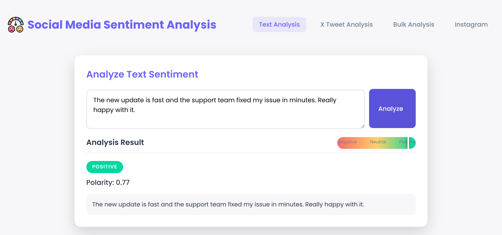

# Social Media Sentiment Analysis

A small Flask app by Yash Suthar that labels text as positive, negative or neutral. It uses two lexicon-based analyzers: NLTK's VADER (the main result) and TextBlob (shown as a second polarity score).



## What it does

- **Text**: paste any text and get a sentiment label and a polarity score.
- **Tweet**: enter a tweet ID or URL. The app fetches the tweet text with the X (Twitter) API v2 and analyzes it. This needs a bearer token.
- **CSV**: upload a CSV file with a column named `text`. Each row is analyzed.
- **Instagram**: enter a post URL and the app reads the caption with Instagrapi, an unofficial Instagram library. The login line in `app.py` is commented out, so this only works after you add your own login.

Text is cleaned first (links, mentions and punctuation are removed). There is no trained model; both analyzers use word lists.

## Tech stack

- Backend: Python, Flask, pandas, NLTK (VADER), TextBlob, requests, Instagrapi
- Frontend: HTML, CSS and JavaScript in `templates/` and `static/`

## Run it locally

```bash
git clone https://github.com/trynayash/social-media-sentiment-analysis.git
cd social-media-sentiment-analysis
pip install -r requirements.txt
python app.py
```

Then open http://localhost:5000. On the first run the app downloads the NLTK data it needs.

For tweet analysis, set your token before starting the app:

```bash
export BEARER_TOKEN="your_x_api_bearer_token"
```

## Project structure

```
app.py          Flask app and all routes
templates/      index.html
static/         CSS, JavaScript and images
Procfile        gunicorn start command
```

## Watermark workflow

`.github/workflows/yashtrap.yml` runs on every push. It adds a credit comment to any `.py`, `.html`, `.js` or `.css` file that does not mention Yash Suthar.

## License

MIT. See [LICENSE](LICENSE).
